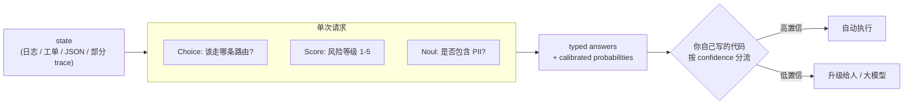

## 证据边界

这篇是 2026-09-23 基于公开资料的整理，**没有实际调用过 Jev API，也没有跑过本地复现**。文中三类信息需要分开看：

- **厂商自报**：TypeSafe 官方文档与发布材料。延迟、成本、加速比全部属于此类。
- **第三方实测**：有具体硬件、样本量、可复现步骤的独立测试。数量很少，但信息量最高。
- **社区生态**：awesome 目录、开源仓库、demo。反映注意力分布，不反映技术质量，且时效性极强。

这条边界不只是免责声明。Jev 最核心的营销点是「校准的概率」，而它恰好是最难被外部验证的部分，现有信息里能验证它的证据最少。第 4 节展开这一点。

---

## 1. 问题：决策为什么不能是文本

主流 LLM 的输出端是**人**：它逐 token 生成自然语言，人读了之后做判断。当消费端换成**程序**时，这条链路就变得别扭——程序需要的不是一段话，而是一个可以直接 `switch` 的值。于是实践中长出了两个补丁：让模型输出 JSON，再解析；或者祈祷 prompt 里的格式约束被遵守。

TypeSafe 的出发点是把这两层都砍掉：**预先定义好答案集合，模型只返回类型化的值**。创始人 Diogo Almeida 是前 OpenAI 研究员、InstructGPT/RLHF 论文作者之一，2026 年 9 月 15 日发布 Jev 并完成 DCVC 领投的 4000 万美元种子轮。他把 Jev 描述成「一个前沿智能的函数调用：非结构化状态进，带概率的类型化决策出」。[1][2]

他自己给出的问题定义不是「模型不够强」，而是**可靠性**。AI 能解数学难题，却自动化不了一件普通工作——缺的是把 AI 接到真实工作上的插头，而插头是代码。由此推出的立场相当激进：**工作流逻辑应该留在普通程序里，AI 只在需要理解或判断的那一步被调用**。他希望 AI 更像一个数据库而不是一个同事：数据库不会思考自己的数据会不会被误用，它只是提供数据。把道德判断嵌进智能本身，在他看来会一层层切碎模型，侵蚀通用能力。[2]

这个定位可以这样对照：

| | Chat / Reasoning 模型 | Jev |
|---|---|---|
| 输出 | 逐 token 生成的文本 | 类型化值 + 概率分布 |
| 消费端 | 人 | 程序 |
| 下游处理 | 解析、校验、正则 | 直接 `switch` / 排序 / 阈值 |
| 延迟量级 | 秒 | 毫秒 |
| 定位 | System 2（慢思考） | System 1（快判断） |

名字取自**杰文斯悖论**：决策成本趋近于零后，决策的**用量**会爆发。这是一个关于需求弹性的赌注，不是关于模型能力的赌注。

---

## 2. 三个原语与并行求值

Jev 的 API 只有三个原语，官方刻意让它们对应经典控制流：

| 原语 | 问的问题 | 返回 | 对应控制流 |
|---|---|---|---|
| **Choice** | 从给定选项里选一个（上限 255） | `choice` + 每项概率 + `confidence` | `switch` |
| **Score** | 按评分标准打分 | `score` + 概率分布 + `confidence` | 排序 / 阈值 |
| **Noul** | 某命题是否成立 | 0–1 的 `P(true)` | `if` |

三者可以在**同一次请求**里混合提交。官方文档里最值得注意的一条机制是：

> Every question is evaluated **in parallel and in isolation** against the same state in one go.

这带来两个可预期的性质：**加问题几乎不增加延迟**，以及**问题之间不会互相污染**（官方称之为不会产生 context rot）。这两点是大模型 prompt 路线做不到的——把 8 个判断塞进一个 prompt，既会变慢，也会让后面的判断被前面的措辞带偏。

配套的两条设计规则：

1. **原子化**。每个问题只做一个单维度判断，标准是「一个知识渊博的人在几秒钟内能做的判断」。
2. **组合写在你自己的代码里**。以评估一个 pitch 为例，官方建议拆成市场规模、技术可行性、差异化三个独立 Score，再用你自己的公式加权。好处说得很直白：优先级变了，**改的是代码里的一个系数，而不是重写 prompt**。

选项超过 255 个时走两阶段模式：先独立打分，再显式选择。

---

## 3. RLCD 与 RLHF 的分歧

Jev 用 TypeSafe 自研的 **RLCD**（Reinforcement Learning for Calibrated Decisions）训练，数据是合成的而非抓取的人类文本。Almeida 把它讲成继 RLHF、RLVR 之后的第三条路，并给出了一个明确的反对理由：

**RLHF 会导致模式坍缩（mode collapse）。** 为了不出错，模型会放弃罕见但有价值的答案，只保留最安全、最被奖励的那些。表面上更稳定，实则**探索范围和判断空间被悄悄压扁**了。他用这个论点解释为什么「字符串输出模型从根上就不适合做决策」——RLHF 会奖励听起来自信的编造，而不是诚实的「我不知道」。

配套的几个立场：

- **拒绝把 refusal 当安全对齐手段。** 对聊天机器人可以，对后端依赖不可接受：一次拒绝就能搞崩下游程序。
- **拒绝刷公开 benchmark。** 他认为 benchmark 容易被 game 成应试；投资人要求过，他拒绝了，并称如果接受妥协，Jev 能早约 18 个月发布。
- **拒绝从头预训练。** 他说即使给他 10 亿美元也不会这么花，宁愿投在数据和 post-training 上。
- **「没有 ML 的 ML」。** ML 依然在用，但整个系统要变得**可测试**——把失败案例固化成测试用例，每次模型更新都重跑。
- **可靠性优先于确定性。** 他不追求「同样的输入给同样的输出」，而是要求**相似**的输入给**相应相似**的输出。他的验收方法是注入变化的 UUID 或随机字符串，看本质上相同的问题是否得到接近的答案。

架构细节没有公开。已知的只有：走 Transformer 路线，合成数据训练，参数量未披露。

---

## 4. 校准：一个最难验证的卖点

Jev 最有价值也最难验证的主张是**概率的可信性**：说 90% 把握，就真有大约 90% 的准确率。程序据此按阈值分流——高置信自动处理，低置信升级——这是整套「双核架构」能成立的前提。

这三组数字放在一起看，才能看清这件事目前的状态：

| 来源 | 数字 | 性质 |
|---|---|---|
| TypeSafe 自报 | 端到端 70–500ms；输入 $0.042/M tokens，输出免费；宣称比前沿模型快 193.6×、便宜 444.6× | 厂商自己的 workflow 评测，官方承认处于真实结果的高位端 |
| 第三方实测（边界判别任务） | 分类一致性与 DeepSeek V4.1 Flash 相当；中位延迟约 0.32s；概率校准方向正确 | 独立，但任务窄 |
| LangChain 实验 | 500/500 判断与人类基准一致，分数方差最小，平均约 0.44s / $0.00035 per case | 独立，但 LangChain 自己标注为「早期、小规模」 |
| 中文客服实测 | 50 题完整准确率约 64–65%，在便宜小模型组里排第二 | 独立，说明判断力并未碾压同级模型 |

而开源复现品的校准数据，恰好从另一侧说明了这件事的难度。Laya 的 model card 写得很坦白：**基础 checkpoint 的 raw ECE 是 0.213，英文版按自己的数据重做温度标定后是 0.081**；multilingual 从 0.314 到 0.106。卡片还主动提示这个模型「出厂时是过度自信的（ships over-confident）」，并给出一个关键对照——**Jev 的 raw ECE 是 0.144**。[3]

也就是说：开源复现品要经过一次**针对你自己数据的重新标定**才能追上 Jev 的出厂校准水平。这既说明 Jev 在这一点上确实有积累，也说明「校准」这件事高度依赖训练分布，不是一个可以靠接口约定绕过去的性质。

已经能确认的失败模式（独立测试报告）：**对选项顺序敏感**，在算术、计数、日期类问题和对抗性输入上不稳定，无法解释自己的推理过程，且官方文档自己标注 **CJK（中日韩）准确率偏低**。[1][4]

---

## 5. 本地复现的三条路径

先明确一件事：**Jev 本体无法本地部署**。它是闭源云端 API，没有公开权重，没有 GGUF，不在 Ollama 上。所以「本地部署 Jev」实际上分化成三条目标不同的路径。

### 路径 A：换模型（用开源复现品顶替）

代表是 **Laya**（Convai Innovations，Apache-2.0，HF 上 2.68k likes）。结构上它不是「小号 Jev」，而是**换了骨架**：

| Checkpoint | 参数 | 骨架 | 上下文 |
|---|---|---|---|
| `laya`（英文根） | 421M | ModernBERT-large (395M) + 从零训的 decision head | 512，其中 options 占 192 |
| `laya-multilingual` | 322M | mmBERT-base，22 层，256k vocab | 1024（mmBERT 编码器带 RoPE 可到 8192） |
| `laya-typed-decisions` | 421M | 同上，针对 typed decisions 微调 | 1024 |

最需要看清的是 model card 自己的定位声明：

> **Laya is a fast base to specialise, not a zero-shot decision engine.**

支撑这句话的数字：**zero-shot typed decisions 准确率 0.362（英文）/ 0.352（多语言）**，而随机基线是 0.318，多数类基线是 0.461。**零样本状态下它连「永远选出现最多的那一类」都打不过。** 微调之后 `laya-typed-decisions` 能到 0.766 argmax（2000 条决策）——但这个 checkpoint 是在该 benchmark 自己的训练划分上调出来的。

还有一个容易被忽略的细节：Laya 的 argmax 准确率（0.766）号称超过 Jev 1.13.0（0.727），但它的 **soft accuracy 是 0.471，Jev 是 0.580**。[3] 换句话说，**选得对不等于概率给得对**——而这恰恰是 Jev 全部价值主张所在。model card 自己也声明，其中所有与 Jev 的对比都是第三方已发布数字，从未在该页面上实测，样本量和 prompt 均不同。

本地运行方式：`pip install laya`（Python 参考实现）、`laya-mlx`（Apple Silicon 的 MLX 移植，峰值约 1GB 内存，M3 Max 上约 60 decisions/sec）、`@receptron/laya`（Node/TypeScript 经 ONNX Runtime，无需运行时 Python，ONNX 权重约 1.7GB fp32）。[3][7]

同赛道还有一批：`jeff`（400M，GliFormer，自称 Jev 的自托管 drop-in）、`Cerebellum-2B`、`OpenSourceJev`、`SemIf`/`OpenJev`、`NanoJev 0.6B`、`Kev 0.5B`、`simple-jev`、`verdict`、`reflex-gate`、`LLM2Jev`。[8]

### 路径 B：换引擎（留着开源模型，改推理方式）

这是目前信息量最大的一条，对整个领域也最有价值。

一位开发者在 RTX 3090 (24GB) 上系统对比了 5 种本地方案加一种级联方案，核心发现是：

> **Jev 的接口——不生成文本、直接读 next-token logprobs——可以在开源模型（Qwen3.5-4B）上极高精度地复现。**

真正的瓶颈**不是模型，是推理引擎**。用 SGLang 的 RadixAttention 缓存共享加 continuous batching，就能用「全量扫描」替代掉有损的 cascade 方案。[5]

实测数据（任务：判断某角色是否在掩饰身份）：

| 方案 | 显存 | 单次判断延迟 | 备注 |
|---|---|---|---|
| SGLang（批处理） | ~20.4 GB | ~27.8 ms（~36 行/秒） | 4994 行《我是猫》138.75 秒扫完，显存全程平稳 |
| llama-server（GGUF Q4_K_M） | ~2.8 GB | ~80–140 ms | 吞吐平台期约 11.87 行/秒 |
| Bonsai 2（27B，BitNet b1.58） | ~5.9 GB | ~330 ms | |
| SemIf | ~8.7 GB | ~400 ms | |
| Laya 322M | ~1.0 GB | ~200 ms | 该任务上把「说谎者」误判为伪装（60.09%） |

作者的建议很具体：**常驻的 agent guardrail 用 `llama-server`，批量语义扫描用 WSL2 + SGLang。**

值得记下的还有一个反例：`BGE-Reranker-v2-m3 + llama-server` 的两阶段级联虽然 12 秒就跑完（416 行/秒），但把目标行排到了第 4359 位——**目标根本没进入第二阶段**。有损的预筛会静默地丢掉正确答案，这正是「全量扫描变得可行」之后应该被淘汰的结构。

需要注意作者自己的限定：这组结果验证的是**边界判别能力**，不是置信度校准，后者他明确说留到后续。

### 路径 C：换客户端（改环境变量指向本地）

`jev-browser-local` 演示了这条路：把 `TYPESAFE_BASE_URL` 指向 localhost，本地实现 TypeSafe 的 `POST /v1/systemone` 契约，桥接到作者自己的 `parallel-decisions`（本地并行约束解码）。决策用 Qwen2.5-1.5B-Instruct，输入/搜索查询用 Qwen2.5-0.5B。目标是 **RTX 2060 SUPER (8GB)**：引擎加载约 20 秒、约 4GB 显存，1.5B fp16 约 3GB，**7B fp16 塞不下**。[6]

测得的端到端结果：Wikipedia 的 Ristretto 检索任务 3 步 5.9 秒达成目标，成本约 $0。

更有价值的是性能修复记录，因为它量化了「候选空间剪枝」的收益：

| 修复 | 前 | 后 |
|---|---|---|
| 240 个候选元素（未剪枝） | 7160 prompt tokens，126 秒/决策 | 剪枝后约 1500 tokens，0.4 秒（0.5B）/ 1 秒（1.5B） |
| chunked prefill + trie 碰撞打分（2026-09-20） | 7.2k-token prefill：11.1 秒 / 7.4 GiB | 0.70 秒 / 1.6 GiB |
| 同上，240 选项决策 | 125.6 秒 | 1.33 秒 |
| 端到端（未剪枝 / 已剪枝） | 49.9 秒 / 5.9 秒 | 22.2 秒 / 4.1 秒 |

作者自己列出的限制同样重要：目标判定用的是 **heuristic 而非模型判断**；引擎的 boolean heads 在这个模型上**基本不可用**；`confidence` 是 **raw softmax 而非训练过的校准**；密集页面上决策质量会退化。服务只绑 127.0.0.1 且没有鉴权。

### 硬件档位

综合以上实测（而非中文搜索里那一批互相矛盾、无实测支撑的「配置要求」文章）：

| 目标 | 门槛 |
|---|---|
| 验证概念 / 玩一玩 | 8GB 显存够用。llama-server + 4B Q4_K_M 约 2.8GB |
| 常驻守门（guardrail） | 8–12GB，llama-server 路线 |
| 批量扫描 / 高吞吐 | 24GB（3090/4090）+ SGLang，这是甜点 |
| 真正替代 Jev | **没有直接路径**：要么拿 Laya 自己微调，要么自建引擎并自行重做校准 |

一个不该被忽略的变量是**显存带宽**，不只是容量。决策类模型对带宽敏感，低带宽的 8GB 卡（如 4060 GDDR6）在这类负载上表现会明显低于同容量的高带宽卡。

---

## 6. 生态：一周 899 个条目的信号价值

`awesome-jev` 社区目录在 2026-09-22 已收录 **899 个条目**，距离 Jev 发布只有一周。[8] 这个数字本身比里面任何单个项目都更能说明当前状态。

分布大致是：

- **SDK**：约 25 种语言。Go 有十几个独立实现，Rust、Swift、Elixir、PHP、.NET、Ruby、Scala、Kotlin、R、Haskell、Zig 各有若干——**Haskell 和 Zig 的 Jev SDK 都在一周内出现了**。
- **基础设施集成**：Vercel AI SDK / AI Gateway、`pg-jev`（Postgres）、`neo4jev`（Neo4j）、`HA-Jev`（Home Assistant）、`llama-index-jev`、n8n 节点、LangGraph。
- **Agent 工具链**（最拥挤也最实用）：`fast-jev-compaction`（Claude Code 上下文压缩）、`jev-router`、`jev-guard`、`jev-firewall`、`jev-review`、`foreman`、`taste-lint`、`typesafe-as-a-judge`，以及大量 MCP server。
- **浏览器 / computer use**：`Jev Ultrafast`（Browser Use 集成）、`typesafe-computer-use`、`mobile-jev`（Android）、`jev-cua`、`otto`，以及给 X / LinkedIn / Gmail / YouTube 做过滤的 Chrome 扩展。
- **应用**：`jev-trader`、`Jev-Moderation-Bot`、`citation-verifier`、`commit-miner`、`jev-reranker`、`typesafe-jev`（简历筛选）、`ai-elo-ranker`。

厂商侧报告的采用速度：上线 Vercel AI Gateway 24 小时内约 13% 的付费团队在使用，36 小时内约 14 万开发者加入内测。[1][4]

两个 demo 值得单独记，因为它们把「延迟」这件事量化了。`laya-vs-jev-arena` 让本地 Laya 和云端 Jev 比赛贪吃蛇，每一步都是真实模型决策，README 记录的结果是：

| | Laya（本地） | Jev（云端） |
|---|---|---|
| 贪吃蛇得分 | 90 | 50 |
| p50 延迟 | ~133 ms（13.4 decisions/s） | ~962 ms（2.9 decisions/s） |
| 8 个固定苹果位置的转向判断 | 7/8，置信度较低 | **8/8** |

README 自己的结论写得比任何评测都清楚：**「Laya's edge here is speed, not judgment.」** 而且 Jev 的延迟数字里包含了作者从印度出发的网络往返。[9]

另一个是 `doom-ai-overlord`，用 Laya 通过 ViZDoom 自动打 Doom。[10]

中文场景里最出圈的是微信插件——判断消息要不要回复、是不是广告、要不要踢人。另有一个「火星消息」实验，本地模型 100 条里对了 53 条。

---

## 7. 张力与开放问题

**① 价值在模型还是在接口？**
路径 B 的发现（Jev 的接口可以在开源模型上高精度复现）直接削弱了护城河论证。如果「读 logprobs + 约束解码 + 并行求值」这套机制是可复制的，那么 Jev 的壁垒就只剩训练数据和校准质量——而这两者恰好是最不透明的部分。目前没有公开证据能判定哪一边成立。

**② 厂商数字与独立数字的落差有多大？**
193.6× / 444.6× 来自厂商自己的 workflow 评测；独立测试给出的是中位延迟约 0.32 秒、分类能力与一个便宜小模型相当。两个量级之间的差距需要用**同一个可复现的 workload** 才能弥合，目前没有这样的公开对比。

**③ 校准主张如何被外部验证？**
「说 90% 就真 90%」是整套架构的承重墙，但验证它需要一个有标注的、分布匹配的数据集，成本不低。现有第三方测试普遍把校准留作「后续工作」（路径 B 的作者就是这么写的）。Laya 的 ECE 数据说明这件事**可以做**，也说明它**必须针对具体分布重做**。如果每个部署方都得自己重标定，「出厂即校准」的卖点就大打折扣。

**④ 零样本 vs 微调：Jev 的优势有多少来自「训练得广」？**
Laya 的 0.362 零样本成绩和 0.766 微调成绩之间的巨大落差说明：决策质量高度依赖任务分布。那么 Jev 的可用性，究竟来自它更聪明的架构，还是来自它在一个足够宽的分布上被训练过？这决定了一个自建方案需要多少标注数据才能追平。

**⑤ 延迟就是智能吗？**
贪吃蛇的结果表明，在实时闭环里，一个本地弱模型可以赢过云端强模型——不是因为更聪明，而是因为不用排队。这个边界的形状值得单独研究：**当决策频率超过某个阈值，本地化的收益是否会压倒模型能力的差距？** 这个阈值对不同的任务类型分别是多少？

**⑥ 注意力 ≠ 存活率。**
899 个 awesome 条目和「24 小时 13% 的 Vercel 付费团队」测量的是注意力峰值，不是留存。一周内出现的 Haskell/Zig SDK 里有多少会在三个月后还有人维护？这个数字目前无法估计，但它决定了这个生态是「新范式」还是「一轮 FOMO」。

**⑦ CJK 缺口。**
官方文档自己标注中日韩准确率偏低。对于中文工作流，这是一个**当下就成立**的阻塞项，而不是未来的优化项。目前没有看到针对性的中文校准方案。

**⑧ 闭源架构的可评估性。**
参数量、网络结构、训练数据规模均未披露。在缺少这些信息的情况下，所有关于「为什么 Jev 能做到」的解释都只能是推测。这让第 ① 和第 ④ 两个问题在短期内都无法收敛。

---

## References

[1] [TypeSafe AI 官方文档](https://docs.typesafe.ai/) — 设计原则、三个原语、并行求值、原子化规则

[2] [专访 Jev 发明者：将工作流程掌握在程序中](https://eu.36kr.com/zh/p/3994032312630020) — Almeida 关于 RLHF 模式坍缩、System 1/2、反模式的原话

[3] [convaiinnovations/laya — Hugging Face model card](https://huggingface.co/convaiinnovations/laya) — 参数、checkpoint、零样本与微调准确率、ECE、soft accuracy 对比

[4] [Jev decision model touted as quicker, cheaper LLM alternative — TechTarget](https://www.techtarget.com/it-infrastructure/news/366650696/Jev-decision-model-touted-as-quicker-cheaper-LLM-alternative)

[5] [Jev をローカルでどこまで再現できるか検証しました — Zenn](https://zenn.dev/null_teck/articles/local-jev-reproduce) — RTX 3090 上的五方案实测与级联反例

[6] [rorshopping/jev-browser-local — GitHub](https://github.com/rorshopping/jev-browser-local) — 本地 systemone 桥接、剪枝收益、修复前后数据、已知限制

[7] [laya-mlx — PyPI](https://pypi.org/project/laya-mlx/) / [receptron/laya — GitHub](https://github.com/receptron/laya)

[8] [hellogumbo/awesome-jev — GitHub](https://github.com/hellogumbo/awesome-jev) — 899 条社区项目索引

[9] [PromptEngineer48/laya-vs-jev-arena — GitHub](https://github.com/PromptEngineer48/laya-vs-jev-arena)

[10] [JohGirard/doom-ai-overlord — GitHub](https://github.com/JohGirard/doom-ai-overlord)

[11] [实测 Jev：没那么强，但足够给有些乏味的 AI 圈带来新刺激 — 品玩](https://www.pingwest.com/a/317597) — 中文客服 50 题实测

[12] [What Is Jev? TypeSafe AI's New System One Model, Explained — Emergent](https://emergent.sh/news/what-is-jev)
